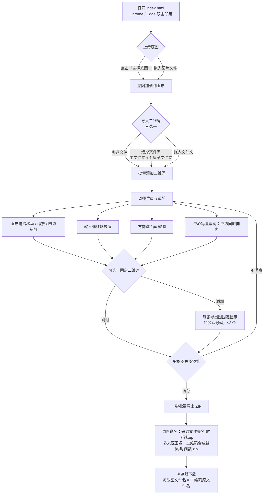
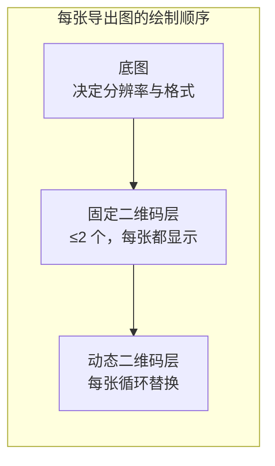
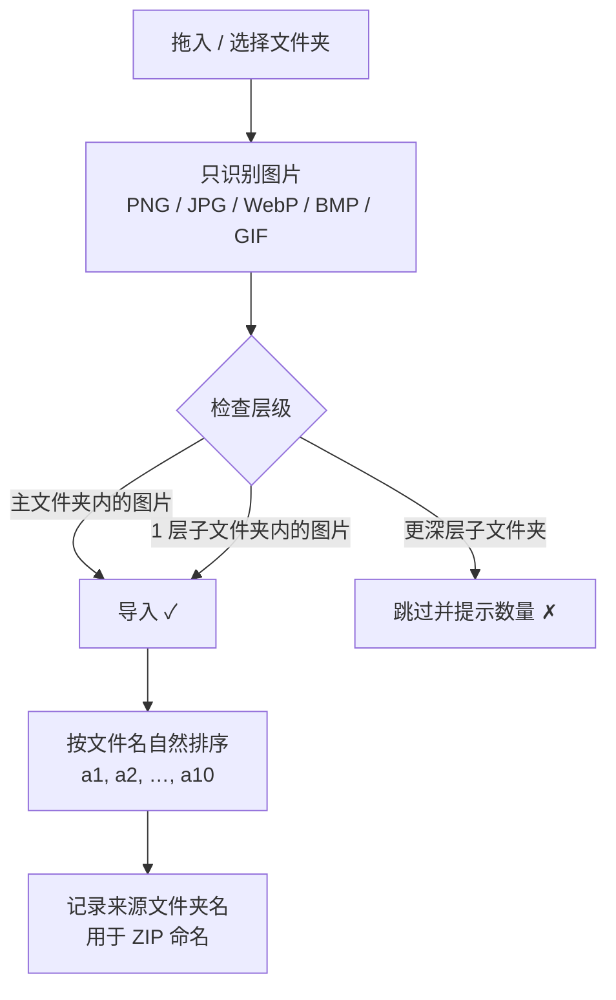

# 操作流程图 · 图片二维码合成工具

> 版本：3.0（2026-11）
> 以下流程图基于 Mermaid，GitHub / 掘金 / 知乎等平台可直接渲染。

## 一、总体操作流程

## 二、数据与图层关系

## 三、文件夹导入规则

## 四、常见问题速查

| 现象 | 原因与解决 |
|---|---|
| 点导出没弹出下载 | 内置预览/沙箱浏览器拦截了下载，ZIP 不会落盘 → 用 Chrome / Edge 打开 `index.html` |
| 拖入文件夹少了几张图 | 位于 2 层及以上子文件夹，超出「主 + 1 层」范围被跳过 |
| 导出顺序和文件名对不上 | 已按文件名自然排序；跨子文件夹同名文件会自动加序号去重 |
| 二维码四周有白边 | 用「中心等量裁剪」四边同时向内裁剪 |

## 如有侵权或意见，可通过邮件联系我： liyulai@qq.com
